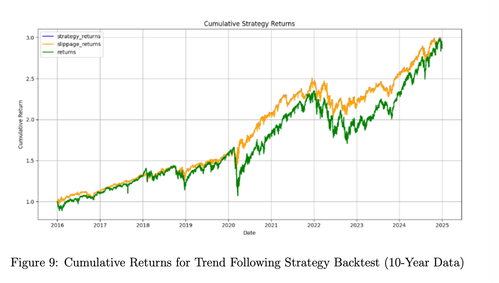
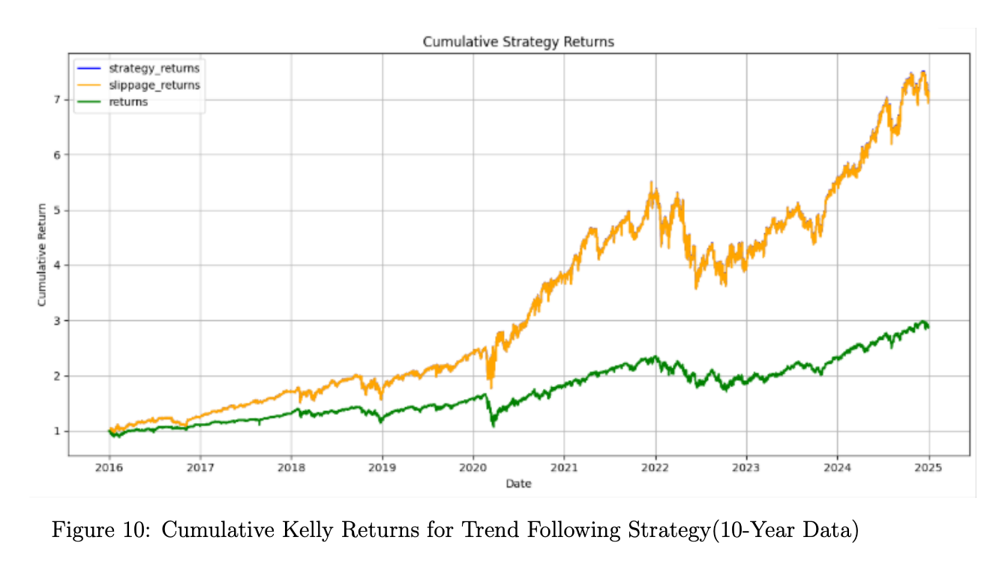

# SPY Systematic Trend Following (15-minute)

An intraday trend-following strategy on the SPY ETF using an EMA 100/200 crossover filtered by volatility, Stochastic RSI and a trend-strength ratio, with Kelly-based sizing and an Alpaca paper-trading version.

## Strategy

**Entry (long)**: EMA 100 above EMA 200, Stochastic RSI rising, ATR above a threshold, and the trend ratio confirming direction.

**Exit**: EMA crossover reversal, or momentum or volatility fading.

**Sizing**: Kelly criterion; 0.1% slippage applied to strategy returns.

## Results

As reported in `notebooks/backtest.ipynb` (not re-run here, because it needs Alpaca market-data access):

| Metric | Value |
| --- | --- |
| Cumulative return | 144% |
| Sharpe | 1.51 |
| Max drawdown | 21% |




## Files

| Path | What it does |
| --- | --- |
| `notebooks/backtest.ipynb` | Backtest on Alpaca historical bars |
| `notebooks/live.ipynb` | Live paper-trading logic (Google Colab) |
| `notebooks/live_data.ipynb` | Live data handling (Google Colab) |
| `results/` | Equity curve charts |

## API keys

The notebooks read Alpaca keys from the environment, never from the code:

```bash
export ALPACA_API_KEY=...      # backtest.ipynb
export ALPACA_SECRET_KEY=...
```

The live notebooks read the same two values from Google Colab secrets (`userdata`).
